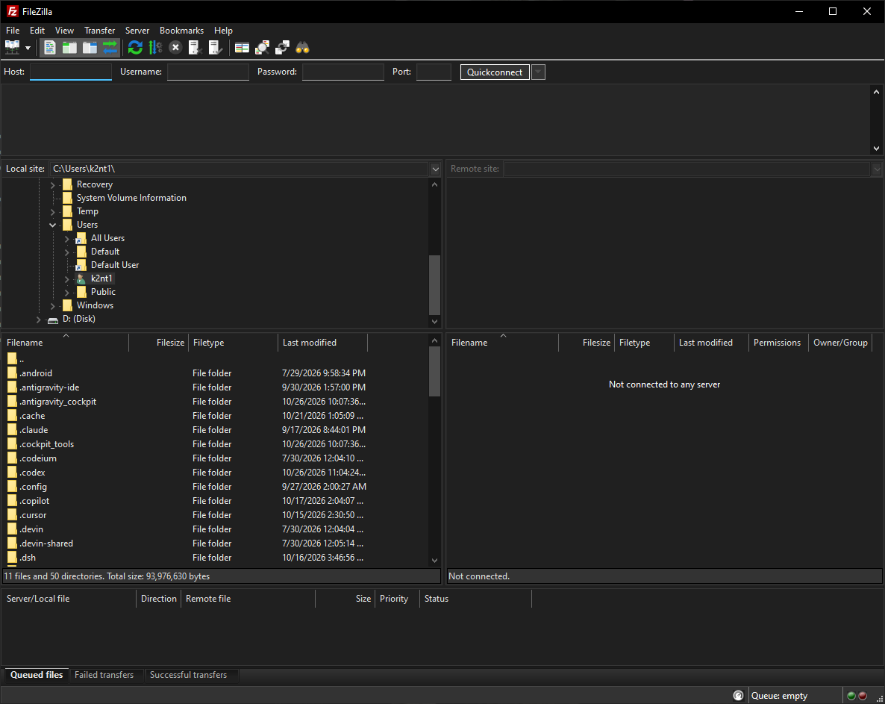

# FileZilla Dark

An unofficial FileZilla Client 3.71.1 fork with native-looking Windows dark mode, **Dark / Light / Follow System** preferences, and portable builds.

## Download

The [first public preview](https://github.com/k2nt1/filezilla-dark/releases/tag/v3.71.1-dark.1) provides two separate RAR archives:

- **[Windows x64 portable program](https://github.com/k2nt1/filezilla-dark/releases/download/v3.71.1-dark.1/FileZilla-Dark-3.71.1-win64.rar)** — extract the entire archive and run `FileZilla-Dark.exe`. The required DLLs, resources, and translations are included; no compiler is needed.
- **[Corresponding source](https://github.com/k2nt1/filezilla-dark/releases/download/v3.71.1-dark.1/FileZilla-Dark-3.71.1-source.rar)** — this fork's source, build recipes, and matching external-library source archives and notices.

The application is rebuilt against wxWidgets 3.3.4 and uses a shared dark palette for windows, menus, fields, file lists, trees, tabs, the message log, and transfer status controls. This changes FileZilla itself; it does not change the Windows theme or the installed FileZilla client.

## Features

- Dark appearance by default, with a persistent selector in **Settings > Interface**. Restart FileZilla after changing the preference.
- Readable message types, directory-comparison colors, certificate warnings, and transfer progress.
- High Contrast takes priority over custom colors, including selections and progress text.
- Portable builds keep their settings in an adjacent `settings` directory.
- Original FTP, FTPS, and SFTP transfer-engine source is preserved.

## Build

See [BUILD.md](BUILD.md) for the MSYS2 UCRT64 build, pinned dependency source hashes, and test commands. The repository contains the modified FileZilla source, including upstream bundled resources and pugixml; external dependency source trees and toolchains are downloaded into a separate build directory.

The ready-to-run portable archive is available under [Releases](https://github.com/k2nt1/filezilla-dark/releases). To compile your own build, follow BUILD.md. Keep the portable executable, its DLLs, resources, and locales together in a writable directory.

## Validation and limits

Local validation on Windows 10 22H2 x64 included 102 engine/path regression cases and 8 GUI utility cases, 69 libfilezilla cases plus its rate-limit test, the fzssh keyfile test, and FTP/explicit-FTPS/SFTP integration using the packaged FileZilla engine. Each protocol passed listing, a 256 KiB upload, download, and upload roundtrip with matching SHA-256 hashes. The user-provided screenshot above verifies the running build's main appearance.

The engine test does not claim to automate every GUI workflow. Windows 11, other DPI/accessibility combinations, and every native Windows dialog still need broader testing. Some OS-native dialogs may remain light. wxWidgets' Windows dark-mode implementation uses undocumented Windows facilities internally; it runs within this application and does not inject into other applications or patch Windows DLL files.

This is an independent customization. For issues specific to the dark fork, use this repository's issue tracker.

## License and attribution

FileZilla Client source remains **GPL version 3 or later**, as stated in the preserved upstream [README](README) and [COPYING](COPYING); [LICENSE](LICENSE) is a verbatim copy of that GPL text. Bundled third-party files retain their own notices and licenses. This fork does not relicense upstream code.

The build links fzssh under **AGPL version 3 or later with additional attribution terms**. See [THIRD-PARTY-NOTICES.md](THIRD-PARTY-NOTICES.md), the complete [fzssh notice](LICENSES/fzssh-README.txt), and the preserved About/legal notices.

**This software incorporates components from fzssh, copyright (c) 2025-2026 Tim Kosse and Business Follows Srl.**
